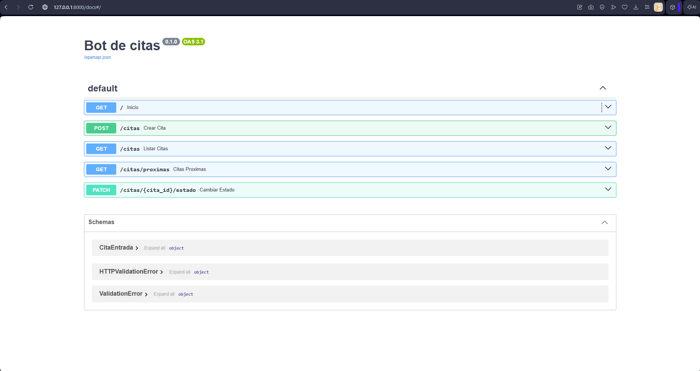

# Bot de citas

## Problema
Un negocio agenda por WhatsApp y pierde citas entre mensajes. Esta API las registra,
las lista por dia y avisa por Telegram de las proximas 24 horas.

## Uso
1. pip install -r requirements.txt
2. uvicorn main:app --reload
3. Abre http://127.0.0.1:8000 y agenda una cita de prueba.

## Endpoints
- POST /citas - crea una cita (nombre, telefono, servicio, fecha_hora ISO)
- GET /citas?fecha=YYYY-MM-DD - lista las citas del dia
- GET /citas/proximas?horas=24 - citas dentro de la ventana
- PATCH /citas/{id}/estado - pendiente, confirmada o cancelada

## Recordatorios
python recordatorio.py 24

Sin TELEGRAM_TOKEN imprime en consola. Con token y chat_id manda el mensaje real
(copia .env.example a .env y carga las variables).

## Notas
- Base SQLite local, un solo archivo. Sin servicios externos obligatorios.
- Sin autenticacion: pensado para uso interno o para montar detras de un login.